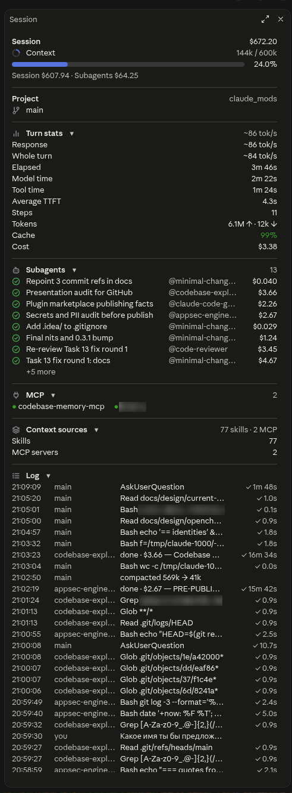

# session-panel

A live session-stats side pane for the Code tab of the Claude desktop app; it opens in a terminal too, with
`/session-panel`. It is a Claude Code plugin built on the mods API: a hooks module that draws a pane. This repository
is a plugin marketplace, `philarete-mods`, that holds this one plugin.

<p align="center">
  
</p>

## What it shows

- **Session**: the session's total cost, a context meter, and the Session / Subagents split once subagents have run.
- **Project**: the project folder, its git branch, and the working tree's changes against HEAD.
- **Usage**: the plan limits (5-hour, Weekly, Spend) as meters with a countdown to each reset.
- **Turn stats**: the main agent's last finished turn: speed, elapsed, model and tool time, steps, tokens and cost.
- **Subagents**: up to 8 rows, running ones first: a status mark, the description, `@type` and cost.
- **Tasks**: the main agent's background Bash commands, Monitors and local Workflows, up to 8 rows, running ones first:
  a status mark, the description, `@shell`, `@monitor` or `@workflow`, and the time.
- **MCP**: the servers that have tools in the context, by name, with their count.
- **Context sources**: how many skills and MCP servers feed the context.
- **Log**: the last 200 events, newest first: prompts, tool calls, subagent spawns, resumes and results, the ends of
  background tasks, compactions. Its header counts the events it has seen, and a `+N more` line counts the ones that do
  not fit.

Every section below the Session and Project blocks can be folded, and the fold state persists. Every rule is in
[the plugin's README](plugins/session-panel/README.md).

## Install

Requires Claude Code 2.1.287 or later (mods support). Tested on Linux with the desktop app (engine 2.1.288) and the
CLI 2.1.294. The Project section needs git.

```bash
claude plugin marketplace add philarete173/claude_mods
claude plugin install session-panel@philarete-mods
```

The marketplace is called `philarete-mods`, while the repository is `claude_mods`.

In the desktop app, `/plugin` does not run in the Code tab. Add the marketplace with the commands above in a terminal,
or through **+** > **Plugins** > **Add plugin**.

On the desktop the pane opens by itself when a session starts. `/session-panel` opens it, or asks to bring it forward
when it is open; in a terminal it is the only way to open it. It works mid-turn too. The command never closes the pane:
its close mark does (ctrl+x x in a terminal).

## Update

Third-party marketplaces do not update by themselves; auto-update is off by default. Update the marketplace and the
plugin:

```bash
claude plugin marketplace update philarete-mods
claude plugin update session-panel@philarete-mods
```

Then start a new session.

## Privacy

- No network access.
- No reading of credentials, environment variables or settings.
- Git runs read-only commands only (`branch`, `rev-parse`, `status` and `diff`), in the session's folder.
- Nothing is written to disk except the fold state, in the plugin store.

The details are in [the plugin's README](plugins/session-panel/README.md).

## Development

Run the tests and the checks:

```bash
claude plugin test plugins/session-panel
claude plugin validate plugins/session-panel
claude plugin validate .
```

For live development, sync the sources into the session's dev folder after each edit. The engine hot-reloads the mod
from there at the end of the main agent's turn.

```bash
rsync -a --delete --exclude '.claude-plugin/types/' --exclude '/tsconfig.json' \
  plugins/session-panel/ ~/.claude/dev-mods/<session-id>/session-panel/
```

After installing the plugin from the marketplace, delete the session's dev copy
(`~/.claude/dev-mods/<session-id>/session-panel/`), or that session loads the mod twice.

To release, bump `version` in `plugins/session-panel/.claude-plugin/plugin.json` only, add an entry to
[CHANGELOG.md](CHANGELOG.md), and run `claude plugin tag plugins/session-panel`, which checks that the manifests agree
and creates the tag `session-panel--vX.Y.Z`. Push `main` and the tag, then publish a GitHub Release from the tag, titled
`session-panel X.Y.Z`, with the CHANGELOG entry as its notes.

The design docs are in [docs/README.md](docs/README.md).

## Credits

Parts of the mod follow these MIT-licensed projects, and the borrowed code is marked in comments.

- [OpenChamber](https://github.com/openchamber/openchamber) (© 2025 Bohdan Triapitsyn): the panel layout and the
  turn-stats and subagent-cost formulas.
- [claude-flightdeck](https://github.com/scasella/claude-flightdeck) (© 2026 Stephen Casella): the secret patterns that
  `redact` applies last, as they were copied, and the session-log design.
- Desktop Statusline by George Liu ([centminmod/claude-plugins](https://github.com/centminmod/claude-plugins)): the
  SVG meter, its colours and thresholds, and the countdown format.

Their license notices are in [THIRD_PARTY_NOTICES.md](plugins/session-panel/THIRD_PARTY_NOTICES.md).

## License

MIT, see [LICENSE](LICENSE). The plugin folder (`plugins/session-panel/`) carries its own copy of the license and the
third-party notices, so an installed copy keeps them.
